<pre>
<b>➜ ~</b> ls -l ~/links
lrwxr-xr-x  web        -> <a href="https://roaziy.dev">roaziy.dev</a>
lrwxr-xr-x  mail       -> <a href="mailto:hello@roaziy.dev">hello@roaziy.dev</a>
lrwxr-xr-x  x          -> <a href="https://x.com/roaziy">x.com/roaziy</a>
lrwxr-xr-x  instagram  -> <a href="https://instagram.com/roaziy">instagram.com/roaziy</a>
lrwxr-xr-x  linkedin   -> <a href="https://linkedin.com/in/roaziy">linkedin.com/in/roaziy</a>
</pre>

<pre>
<b>➜ ~</b> exit

[Process completed]
</pre>

